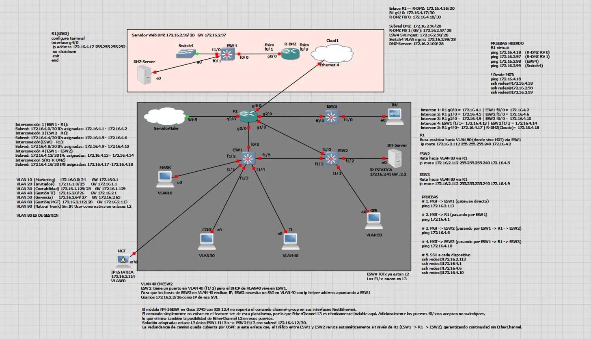

# Gestión de una red empresarial (FCAPS) — Redes de Datos 2

Proyecto grupal de la asignatura **Redes de Datos 2** (Universidad Nacional de Colombia, sede Manizales). Diseño y simulación en GNS3 de la red de una empresa ficticia de reservas hoteleras, **EasyStay**, organizada según el modelo **FCAPS** (fallas, configuración, contabilidad, rendimiento y seguridad). El sistema de información de la empresa es un aplicativo web de reservas desarrollado en una asignatura anterior.

> **Estado:** primera versión. Incluye diagrama, direccionamiento y configuración inicial de R1. Pendiente de agregar: configuraciones de los demás equipos, scripts de automatización y monitoreo, y muestras de resultados.

## Topología

- Núcleo con router **R1**, tres switches de capa 3 (ESW1, ESW2, ESW3) y una zona **DMZ** con servidor web y router propio.
- Segmentación por VLAN (marketing, invitados, contabilidad, gestión TI, gerencia y gestión de red).
- Direccionamiento en [`docs/direccionamiento.md`](docs/direccionamiento.md).

## Estado por área de FCAPS

| Área | Qué se hizo | Estado |
|---|---|---|
| Fallas | Monitoreo y alertas básicas con scripts de Python desde el equipo MGT | Scripts por publicar |
| Configuración | Configuración inicial en los equipos; el resto (por ejemplo OSPF) se aplica con un script de Python desde MGT | Por documentar |
| Contabilidad | | Por documentar |
| Rendimiento | | Por documentar |
| Seguridad | Segmentación por VLAN, ACL por zona (aislamiento de invitados, DMZ, acceso al servidor), SSH versión 2 con autenticación local y NAT | Parcial; ver observaciones |

## Decisiones de diseño
- **EtherChannel no se implementó.** El módulo NM-16ESW emulado en Cisco 3745 con IOS 12.4 no soporta `channel-group` en sus interfaces FastEthernet, así que se usó un enlace L3 único entre ESW1 y ESW2 (`172.16.4.12/30`). La redundancia de camino se apoya en el ruteo dinámico a través de R1.
- **VLAN 40 en ESW2:** el DHCP de esa VLAN vive en ESW1, por lo que ESW2 tiene un SVI en VLAN 40 con `ip helper-address`.

## Observaciones conocidas
Cosas que detectamos al revisar el proyecto y que quedan documentadas, no ocultas:
- **Conexión con la nube:** diseñada, pero no implementada.
- **ACL `INBOUND_INTERNET` en R1:** tiene un `permit ip any any` antes del `deny` hacia la red interna, por lo que ese `deny` nunca se evalúa. Mejora pendiente: reordenar y probar.
- **ACL `OUTBOUND_VLAN80`:** definida en R1 pero no aplicada a ninguna interfaz allí. Por verificar si se aplica en otro equipo.
- **Configuración publicada de R1:** es la inicial; el ruteo dinámico se aplica después con el script de MGT.
- Las configuraciones de laboratorio usan líneas de consola sin tiempo de espera y privilegios altos, lo que no sería aceptable en producción.

## Alcance y límites
- No se incluyen imágenes de IOS ni discos de máquinas virtuales (licencia y tamaño).
- Los secretos de las configuraciones están reemplazados por `<REDACTED>`.
